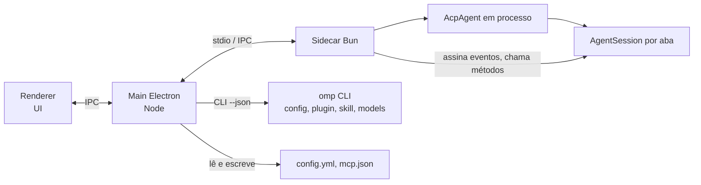

# Arquitetura proposta

Status: desenho confirmado pelo spike de 2026-10-24 (`spike.md`, seção Resultados), com ressalvas no ADR 0001. Decisão de base: `adr/0001-integracao-acp-sdk-patches.md`.

## Processos

## Responsabilidades

| Parte | Faz | Não faz |
|---|---|---|
| Renderer | telas, paleta de comandos, diálogos de aprovação e `ask` | fala com o omp direto |
| Main (Node) | janelas, ciclo de vida do sidecar, IPC, chama a CLI de gestão | importa código do omp (exige Bun) |
| Sidecar (Bun) | roda `AcpAgent`, guarda as `AgentSession`, repassa eventos completos, expõe pause, clear, vibe, plan | desenha UI |
| omp CLI | leitura e escrita de settings, plugins, skills, modelos, uso | MCP (não há subcomando) |

## Fluxos que o desenho precisa sustentar

- **Prompt**: renderer → main → sidecar → `session/prompt`. Eventos voltam por duas vias: `sessionUpdate` do ACP e assinatura direta da `AgentSession` (cobre o que o ACP descarta, ver `research/02-acp.md`).
- **Aprovação de tool**: `session/request_permission` com `allow_once`, `allow_always`, `reject_once`, `reject_always`. O desktop declara `elicitation.form` no `initialize`, senão `ask` e a aprovação de plano degradam.
- **MCP**: main lê `mcp.json` (usuário e projeto) e o sidecar repassa `mcpServers` em `newSession`, `loadSession` e `resumeSession`. O disco é ignorado no ACP.
- **Settings**: formulário gerado dos metadados de `config/registry.ts`; escrita por `omp config set` ou pela API. Sidecar chama `reloadFromDisk()` após escrita, pois o ACP não tem watcher.
- **Approval por política**: não há campo por sessão; política diferente exige outro processo `omp acp` (`docs/approval-mode.md:191`).
- **Startup do sidecar**: chamar `ensureTheme()` de `@oh-my-pi/pi-tui/theme`. Sem isso a tool `ask` falha (verificado no spike).

## Pontos em aberto

- ~~Um sidecar ou um por aba~~ Decidido (2026-10-24): sidecar único. "Parar" por aba é `session/cancel` (verificado). `/pause` fica global, como no TUI, ou fora da primeira versão; gate por sessão exigiria patch no omp. Jobs em background e subagents não são derrubados pelo "parar"; matar um job é ação explícita na UI (ver ADR 0001).
- Distribuição do Bun (embarcar ou localizar).
- Login OAuth pelo desktop (`authStorage.oauth.login` com um `OAuthLoginController`). Gravar API key já funciona por `authStorage.credentials.set`.
